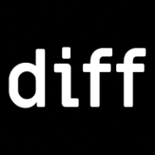

<div align="center">



### diffpack

**Compare package versions across ecosystems.**<br>
Clean. Fast. Source-aware.

[**diffpack.io**](https://diffpack.io) · [Contributing](CONTRIBUTING.md) · [Agent guide](AGENTS.md)

[](CONTRIBUTING.md#what-fallow-enforces-here)

</div>

<br>

Paste two versions of a package and read what actually changed — the files, the lines, the
renames — without cloning anything or trusting a changelog.

<br>

### A diff is a URL

```
diffpack.io / npm / zod / 3.25.76 / 4.0.0 / src/types.ts
              │     │     │         │       │
              │     │     │         │       └── file to open   (optional)
              │     │     │         └────────── to
              │     │     └──────────────────── from
              │     └────────────────────────── package
              └──────────────────────────────── registry
```

Every state of the app is addressable, so whatever you are looking at is a link you can send to
someone.

<br>

### It runs in your browser

```
   npm · crates.io · PyPI · Go ───────────── archives ─────────────┐
                                                                   ├──▶ your browser
   Packagist · GitHub ── metadata, archives ──▶ diffpack-proxy ────┘          │
                                                                         wasm worker
                                                                              │
                                                                            diff ──▶ you
```

### Registries

| | Registry | Language | Search |
| :-- | :-- | :-- | :-- |
| ⬢ | **npm** | JavaScript & TypeScript | yes |
| ⬢ | **crates.io** | Rust | yes |
| ⬢ | **PyPI** | Python | yes |
| ⬢ | **Packagist** | PHP (Composer) | yes |
| ⬢ | **Go** | Go modules | yes, through the proxy |

> Go search asks [pkg.go.dev](https://pkg.go.dev) through diffpack-proxy, since pkg.go.dev's search
> sends no CORS header. A module it does not list can still be opened by typing its full path
> (`github.com/go-chi/chi/v5`) and pressing Enter.

> Packagist names are `vendor/package` (`monolog/monolog`), so a Composer URL spends two segments
> on the name: `/composer/monolog/monolog/3.12.0/3.12.1`. It is the one registry the browser does
> not reach on its own: its version metadata and archives come through a small proxy, described
> under [It runs in your browser](#it-runs-in-your-browser).

More registries are on the way.

<br>

### Quick start

Needs [Bun](https://bun.sh). Nothing else — no Rust toolchain, no build step in front of `dev`.

```bash
bun install
bun run dev          # http://localhost:4321
```

That is the whole setup. `bun install` brings the compiled diff engine down with everything else.

<br>

### The engine is a separate repo

Extraction and diffing — everything that fetches a tarball, unpacks it and compares two versions —
is Rust compiled to WebAssembly, and it lives in
**[philfreshman/diffpack-engine](https://github.com/philfreshman/diffpack-engine)**. This repo
consumes it and never builds it:

```
  diffpack-engine  ──▶  @philfreshman/diffpack-engine  ──▶  diffpack
   Rust crate            npm · wasm-pack                    a dependency
   its own CI            provenance-signed                  pinned in package.json
```

| To | |
| :-- | :-- |
| change what you see | a PR here |
| change how a diff is computed | a PR in **diffpack-engine** |
| try an engine change before releasing it | `DIFFPACK_ENGINE_LOCAL=../diffpack-engine/pkg bun run dev` |
| ship an engine change | tag `v*` there, then bump the version here |

Nothing here compiles Rust — not `dev`, not `build`, not CI, not the Vercel deploy. The cost of
that is a seam: an engine change is not proved against the app until its version moves in
`package.json`. The engine's own CI runs its `#[wasm_bindgen]` boundary in a real browser to cover
the gap, and the bump PR here runs the full end-to-end suite, which makes it one to read rather
than wave through.

See [CONTRIBUTING.md](CONTRIBUTING.md#the-engine) for the detail.

<br>

### The four repositories

diffpack is split across four repositories that are meant to be cloned as siblings under one
parent directory — which is what `DIFFPACK_ENGINE_LOCAL=../diffpack-engine/pkg` and every relative
path below assumes:

```
<parent>/
├── diffpack/          github.com/philfreshman/diffpack
├── diffpack-engine/   github.com/philfreshman/diffpack-engine
├── diffpack-proxy/    github.com/philfreshman/diffpack-proxy
└── diffpack-server/   github.com/philfreshman/diffpack-server
```

| Repo | What lives there |
| :-- | :-- |
| **diffpack** | The web app — TanStack Start, the UI, the registry adapters, the worker that drives the engine. Deployed to [diffpack.io](https://diffpack.io). |
| **diffpack-engine** | The Rust crate compiled to WebAssembly: fetching archives, extraction, the diff and the file tree. Published to npm as `@philfreshman/diffpack-engine` and consumed by the app as a pinned dependency; the app never builds it. |
| **diffpack-proxy** | A Cloudflare Worker that fetches Packagist's version metadata and Composer archives for the browser and adds the CORS header they lack. It streams the bytes without storing them and serves only archives Packagist lists. The app calls it for Composer versions and Go keyword search, the engine for Composer archives. |
| **diffpack-server** | An MCP server at `mcp.diffpack.io` that diffs packages for AI agents with the same engine, natively, and caches the results. The app reads that cache by `diff_id` and computes the key itself, held to the server's `fixtures/cache-key-vectors.json`. |

Nothing links them at build time except that npm package (the proxy is reached over HTTP, at run
time), so a change that crosses a boundary crosses a release: see
[the engine section](#the-engine-is-a-separate-repo) for how an engine change reaches the app.

<br>

### Scripts

| | |
| :-- | :-- |
| `bun run dev` | Vite dev server on `:4321` |
| `bun run build` | `vite build` (Nitro writes `.vercel/output/`) |
| `bun run preview` | serve the production build |
| `bun run test` | unit tests (`bun test tests/unit`) |
| `bun run test:e2e` | Playwright — hits the real registries, so slow and online |
| `bun run test:networked` | the cache key checked against the live diffpack-server's own `diff_id`s |
| `bun run check:vectors` | `fixtures/cache-key-vectors.json` is byte-identical to the server's at a pinned commit (`:development` compares with the server's tip) |
| `bun run screenshots` | recapture the reference set (`scripts/capture-screenshots.mjs`) |
| `bun run typecheck` | `tsc --noEmit` |
| `bun run lint` · `format` | oxlint · oxfmt (check only; `bunx oxfmt` writes) |

<br>

### Stack

| | |
| :-- | :-- |
| **App** | [TanStack Start](https://tanstack.com/start) + [Router](https://tanstack.com/router) on Vite — the shell is SSR'd whole, the diff engine stays strictly client-side; only Composer's downloads and Go keyword search pass through the proxy |
| **State** | [Query](https://tanstack.com/query) for registry calls, [Store](https://tanstack.com/store) for the diff session |
| **UI** | [Base UI](https://base-ui.com) primitives wrapped in `src/components/ui`, CSS Modules over a custom-property token layer — no Tailwind; [React Compiler](https://react.dev/learn/react-compiler) (its Rust port) memoizes at build time |
| **Engine** | Rust → WebAssembly for extraction and diffing, in its own repo: [diffpack-engine](https://github.com/philfreshman/diffpack-engine) |
| **Tooling** | [oxlint and oxfmt](https://oxc.rs), [fallow](https://fallow.tools) |

<br>

<details>
<summary><b>Deployment</b> — Vercel, and three things to know before editing deploy config</summary>

<br>

Vercel via the [Nitro](https://nitro.build) Vite plugin: `vite build` writes a Build Output API v3
tree to `.vercel/output/` — static assets plus one server function — which Vercel serves as-is.

**Routing and headers belong in `nitro({ routeRules })` in `vite.config.ts`, not `vercel.json`.**
A build that writes `.vercel/output/config.json` brings its own routing table, so rules left in
`vercel.json` are read by nobody. What `vercel.json` still carries is the build command — the
install command it used to need, which installed a Rust target and compiled the engine before
`bun install` could run, went away when the engine became a published package — and the rule
below. Confirm a change landed by reading `.vercel/output/config.json` after
`VERCEL=1 bun run build`.

**Only `main` deploys.** `git.deploymentEnabled` turns every other branch off, so pushing to
`development` or opening a PR no longer builds a preview. Previews were not being used and each
one was a full production build, so the cost was real and the output was read by nobody. The
pattern is `"**": false` with `"main": true` on top of it: Vercel matches branch names with
minimatch and deploys when *any* matching rule is true, so the specific entry wins over the
wildcard. A branch that needs a URL gets one from `vercel deploy` rather than from a push.

**The `www.diffpack.io` → `diffpack.io` redirect is a domain setting in the Vercel project**, not
something this repo configures — `routeRules` match on path, not host.

</details>

<br>

<div align="center">
<sub>Contributions welcome — start at <a href="CONTRIBUTING.md">CONTRIBUTING.md</a>.</sub>
</div>
